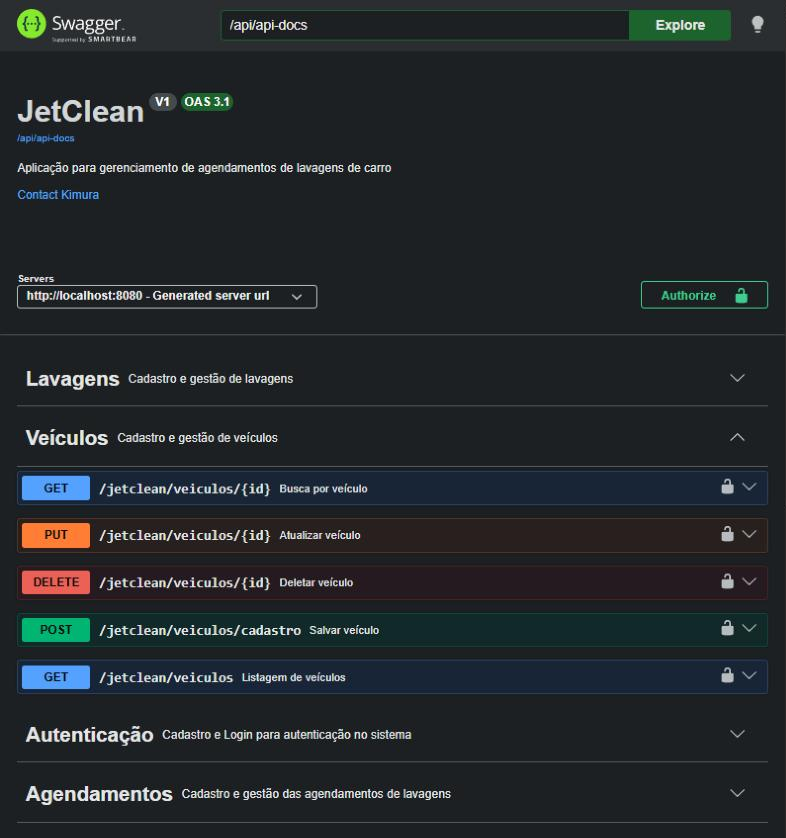

# JetClean 🚗
Projeto concluído, atualmente em sua V1 funcional.

O **JetClean** é uma API REST em Spring Boot para gerenciamento de um lava-jato: cadastro de veículos, catálogo de lavagens e agendamentos, com autenticação via JWT.

Este projeto tem como objetivo estudar o ciclo completo de um backend REST: modelagem com JPA, versionamento do banco com Flyway, validação de dados com DTOs, regras de negócio, tratamento global de erros, autenticação stateless com Spring Security e JWT, e documentação da API com Swagger.


## ✨ Funcionalidades atuais

- Cadastro, listagem, edição e exclusão de veículos, com placa única.
- Cadastro, listagem, edição e exclusão de lavagens, com preço e data da última edição.
- Agendamento de lavagens para veículos, sempre em data futura.
- Cadastro de usuários com senha criptografada (BCrypt).
- Login com geração de token JWT, válido por 24 horas.
- Todas as rotas protegidas por token, exceto cadastro e login.
- Tratamento global de erros com respostas padronizadas (400, 401, 404 e 409).
- Bloqueio da exclusão de veículos e lavagens que possuem agendamentos.
- Documentação interativa com Swagger, com suporte ao token JWT.
- Persistência dos dados em PostgreSQL executado em container local.

## 🛠️ Tecnologias

[](https://www.java.com)
[](https://spring.io/projects/spring-boot)
[](https://spring.io/projects/spring-security)
[](https://jwt.io)
[](https://maven.apache.org)
[](https://www.postgresql.org/)
[](https://flywaydb.org)
[](https://swagger.io)
[](https://www.docker.com)
[](https://git-scm.com)


## 🚀 Como rodar localmente

O projeto utiliza uma variável de ambiente para o secret do JWT.

| Variável | Descrição |
| --- | --- |
| `JWT_SECRET` | Chave usada para assinar e validar os tokens JWT. Use pelo menos 32 caracteres aleatórios. |

> Não versionar chaves, senhas ou credenciais reais no repositório.

1. Suba o banco PostgreSQL em um container:

```bash
docker run -d --name jetclean-db -e POSTGRES_PASSWORD=postgres -e POSTGRES_DB=jetclean -p 5432:5432 -v jetclean-data:/var/lib/postgresql/data postgres:16
```

2. Defina a variável `JWT_SECRET` (no IntelliJ: *Run → Edit Configurations → Environment variables*).

3. Rode a aplicação. O Flyway cria as tabelas automaticamente na primeira execução.

```bash
./mvnw spring-boot:run
```

4. Acesse a documentação em `http://localhost:8080/swagger/index.html`.


## 🔐 Autenticação

1. Cadastre um usuário em `POST /jetclean/auth/register`.
2. Faça login em `POST /jetclean/auth/login` e copie o token retornado.
3. Envie o token nas demais requisições pelo header `Authorization: Bearer <token>`.

No Swagger, basta clicar em **Authorize** e colar o token.


## Principais Rotas utilizadas.

Autenticação (rotas públicas):

- POST /jetclean/auth/register
- POST /jetclean/auth/login

Veículos:

- GET /jetclean/veiculos
- GET /jetclean/veiculos/{id}
- POST /jetclean/veiculos/cadastro
- PUT /jetclean/veiculos/{id}
- DELETE /jetclean/veiculos/{id}

Lavagens:

- GET /jetclean/lavagens
- GET /jetclean/lavagens/{id}
- POST /jetclean/lavagens/cadastro
- PUT /jetclean/lavagens/{id}
- DELETE /jetclean/lavagens/{id}

Agendamentos:

- GET /jetclean/agendamentos
- GET /jetclean/agendamentos/{id}
- POST /jetclean/agendamentos/cadastro
- PUT /jetclean/agendamentos/{id}
- DELETE /jetclean/agendamentos/{id}

Todos os endpoints estão documentados e podem ser testados pelo Swagger.


## ⚠️ Respostas de erro

| Status | Quando acontece |
| --- | --- |
| `400` | Campo obrigatório vazio, tamanho inválido, JSON malformado ou tipo de veículo inexistente. |
| `401` | E-mail ou senha inválidos no login. |
| `403` | Requisição sem token ou com token inválido. |
| `404` | Veículo, lavagem ou agendamento não encontrado. |
| `409` | Placa já cadastrada, ou exclusão de veículo/lavagem que possui agendamentos. |


## 📸 Demonstração

Documentação da API no Swagger:


